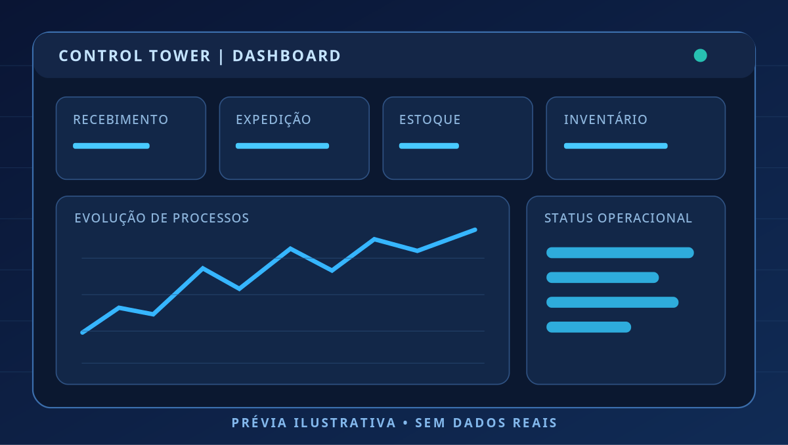
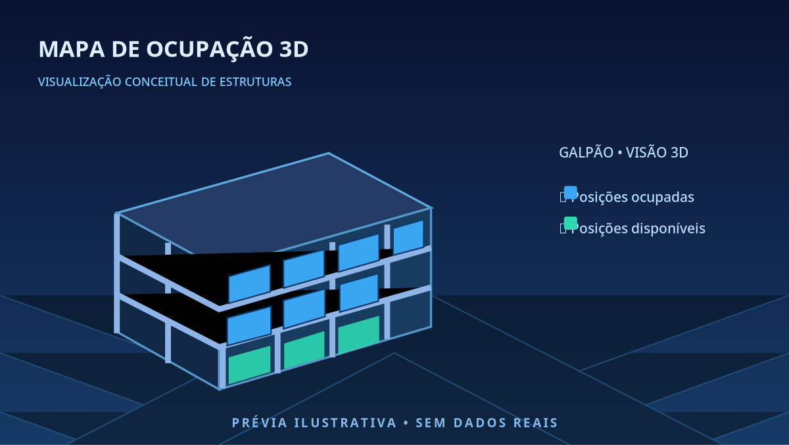
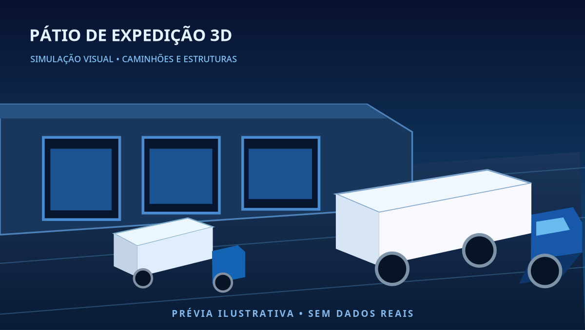

  

<h1 align="center">Olá, eu sou Lucas Martinez 👋</h1>

<strong>Desenvolvimento de software · Automação · Inteligência Artificial · Dashboards</strong>

Transformo desafios reais em experiências digitais, interfaces e soluções úteis.

---

### 👨‍💻 Sobre mim

Sou apaixonado por tecnologia aplicada à prática. Desenvolvo e estudo soluções que combinam **interfaces web, automação, análise e visualização de dados, inteligência artificial e organização de processos**. Minha experiência na construção de ferramentas e dashboards está ligada especialmente à melhoria de fluxos e à transformação de informações complexas em telas mais simples e eficientes.

Tenho interesse em evoluir continuamente como desenvolvedor: da ideia e prototipação até os testes, a melhoria de usabilidade e a manutenção das soluções.

### 🛠️ Áreas e tecnologias presentes nos meus projetos

**Interfaces:** HTML, CSS, JavaScript, React e TypeScript  
**Aplicações e serviços:** Python, Node.js e APIs  
**Dados e automação:** dashboards, integração de informações e inteligência artificial  
**Práticas:** Git, GitHub, documentação técnica e design responsivo

### 🖼️ Galeria visual de projetos

Os projetos operacionais abaixo são apresentados **somente por representações visuais**. Seus códigos, bancos de dados, integrações, arquivos internos e informações de produção não são disponibilizados publicamente.

> **Nota de transparência:** as imagens seguintes são **ilustrações conceituais**, e não capturas originais dos sistemas. Imagens reais só devem ser incluídas após autorização e remoção de dados confidenciais.

#### Control Tower — painel operacional

Design de dashboards para apresentar indicadores e fluxos de informação em telas de acompanhamento.

#### Ocupação 3D — visualização de estoque

Visualização de estruturas e espaços de armazenagem em interfaces de leitura intuitiva.

#### Pátio e Expedição 3D

Representação visual de etapas logísticas, caminhões e estruturas de expedição.

---

### 🎯 Meu objetivo

Criar software que resolva problemas concretos, com atenção a qualidade visual, facilidade de uso, confiabilidade e evolução contínua.

<em>Projetos reais. Aprendizado constante. Tecnologia com propósito.</em>

