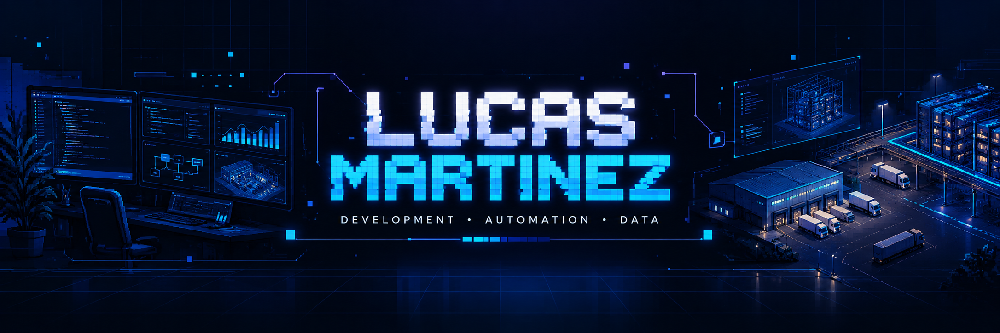
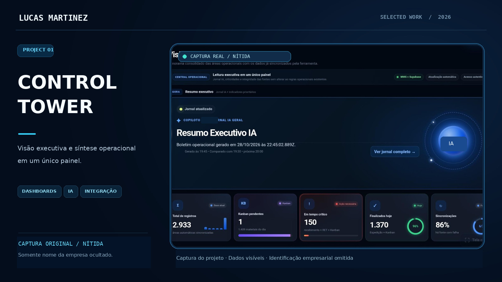
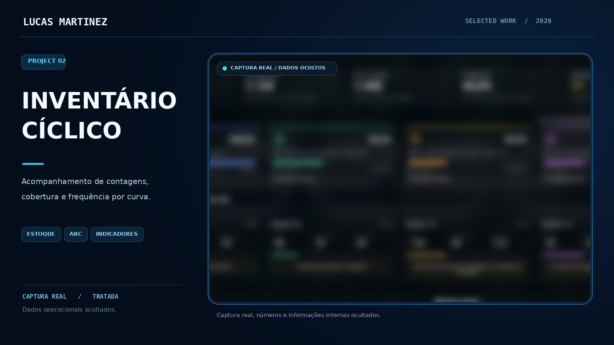
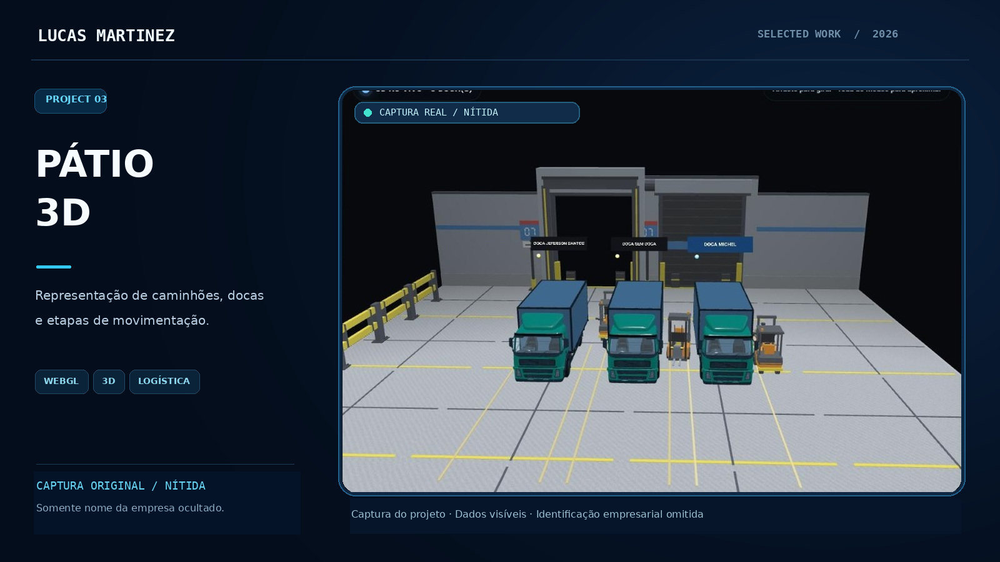
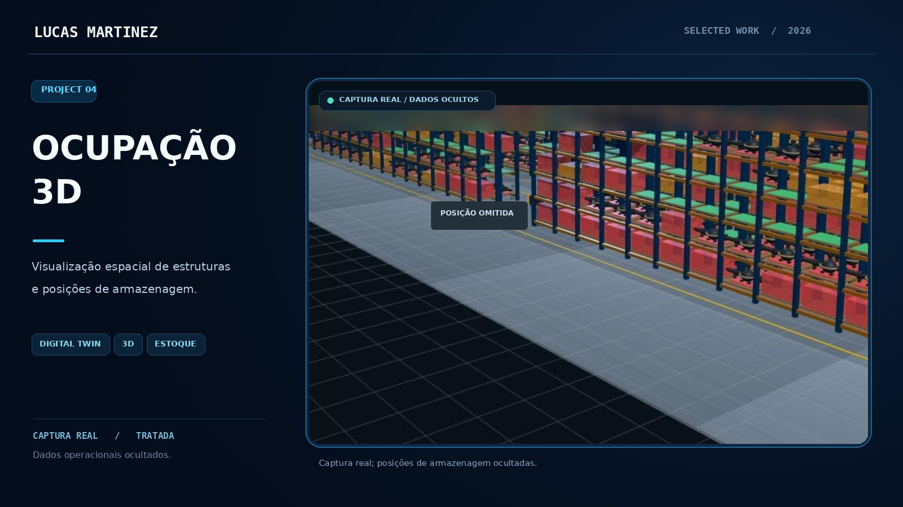
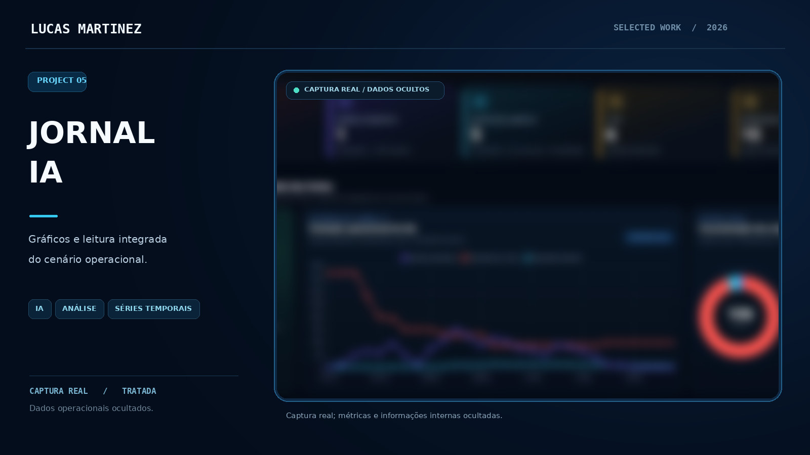
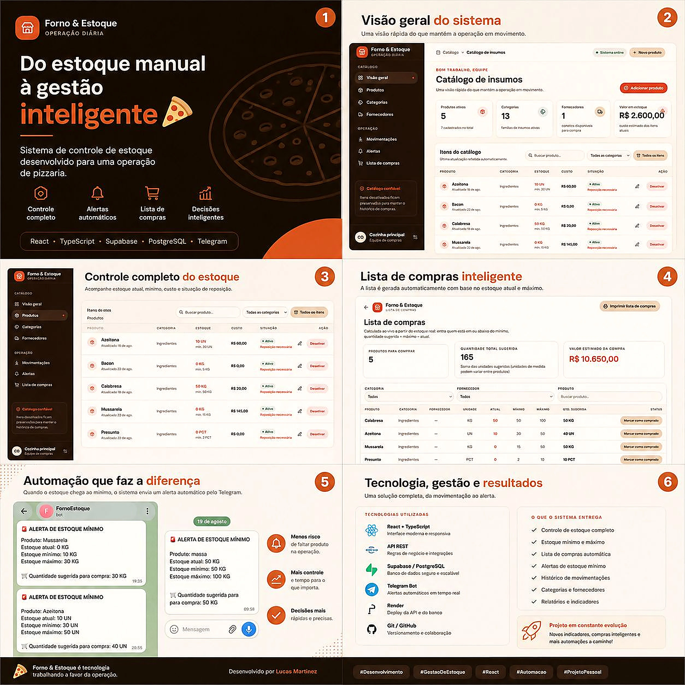
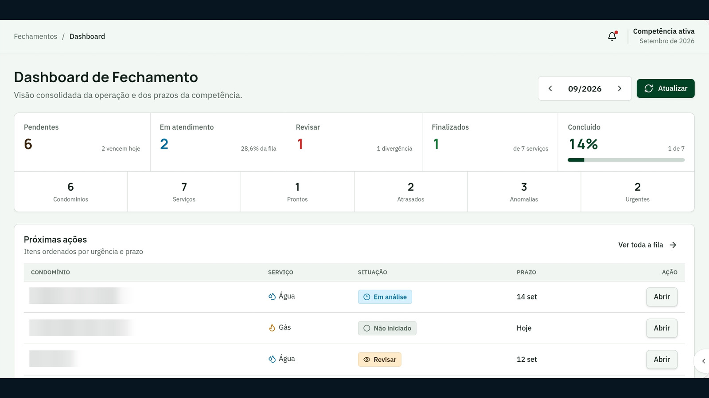
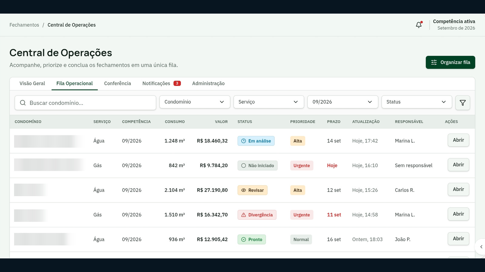

# Olá, eu sou Lucas Martinez 👋

**Desenvolvimento de software · Automação · Inteligência Artificial · Visualização de dados**

Transformando desafios do dia a dia em interfaces, ferramentas e experiências digitais.

[🌐 **Acessar meu portfólio profissional**](https://lucas-martinez-portfolio.vercel.app/)

<a href="#sobre-mim">Sobre mim</a> • <a href="#tecnologias">Tecnologias</a> • <a href="#projetos-em-imagens">Projetos</a> • <a href="#contato">Contato</a>

---

## 👨‍💻 Sobre mim

Gosto de conectar **tecnologia, análise de dados e problemas reais**. Meu foco está no desenvolvimento de soluções digitais que facilitem a visualização de informações, a organização de atividades e o acompanhamento de processos.

Trabalho e estudo na interseção entre **desenvolvimento web, automação, dashboards, logística e inteligência artificial**. Tenho especial interesse em interfaces bem construídas, boa usabilidade e evolução contínua dos projetos.

> **Meu princípio:** tecnologia útil, comunicação visual clara e aprendizado constante.

## 🧰 Tecnologias presentes nos meus projetos

Esta lista apresenta tecnologias encontradas em projetos e estudos. Não representa certificações ou níveis declarados de proficiência.

## 🖼️ · Galeria de projetos

Uma seleção **visual** de dashboards, interfaces e ambientes 3D, incluindo projetos independentes. As capturas operacionais são apresentadas com identificação da empresa ocultada. **Nenhum código, banco de dados, endpoint ou arquivo interno é disponibilizado.**

> **Privacidade:** imagens dos projetos preparadas para ocultar a identidade da empresa, sem representar relatórios públicos. Conteúdos de sistemas internos, credenciais e repositórios privados não são disponibilizados.

### 01 · Control Tower — Visão Executiva

Painel centralizado que organiza indicadores, jornal com IA e sinais de acompanhamento em uma leitura executiva.

### 02 · Inventário Cíclico

Visualização de cobertura, frequência e acompanhamento de contagens por classificação de materiais.

### 03 · Pátio e Expedição 3D

Cenário tridimensional representando docas, caminhões e empilhadeiras, sem identificação de clientes ou veículos.

### 04 · Ocupação de Estoque 3D

Visualização espacial de estruturas de armazenamento e ocupação com foco em navegação e identificação visual.

### 05 · Jornal IA e Análise Operacional

Experimentos em síntese visual, séries temporais e acompanhamento de indicadores para apoiar a leitura operacional.

### 06 · Forno & Estoque — Gestão Inteligente para Pizzaria

  

Projeto independente de gestão de estoque para pizzaria, com controle de produtos, categorias, fornecedores, custos e movimentações. A solução considera estoque mínimo e máximo, sugere quantidades para reposição e envia **alertas automáticos pelo Telegram**.

**Tecnologias:** React · TypeScript · API REST · Supabase / PostgreSQL · Telegram Bot · Render.

[**Conhecer o projeto e seu estudo de caso**](https://lucas-martinez-portfolio.vercel.app/forno-estoque.html) · Código-fonte privado.

### 07 · Gás & Condomínio — Gestão de Água e Gás

  

  

**Projeto independente com repositório privado.** Sistema para gerenciar fechamentos mensais, contas de concessionárias, leituras de medidores, consumo, pendências e divergências, com relatórios e histórico para conferência.

**Tecnologias:** Node.js · Express · PostgreSQL / Supabase · API REST · Automação. Nenhum código, conta ou informação de condomínios é divulgado publicamente.

---
## ✨ Como gosto de construir soluções

| 🎨 Interface e UX | 📊 Dados e dashboards | ⚙️ Automação |
| :--- | :--- | :--- |
| Layouts responsivos e informação legível. | Indicadores e visualizações organizadas. | Redução de etapas manuais e padronização de fluxos. |

| 🧠 Inteligência artificial | 🧩 Integração | 🔄 Evolução contínua |
| :--- | :--- | :--- |
| Exploração de aplicações práticas de IA. | Conexão entre interfaces e serviços. | Testes, documentação e melhorias graduais. |

## 🎓 Formação acadêmica

**Análise e Desenvolvimento de Sistemas — Anhanguera**  
Graduação em andamento · Início em **fevereiro de 2026**.

## 📚 Em desenvolvimento contínuo

Aprofundo meus conhecimentos em **engenharia de software, Git/GitHub, interfaces web, automação e aplicações com IA**, sempre buscando transformar estudo em projetos práticos. As informações deste perfil se limitam ao que pode ser apresentado publicamente.

## 🤝 Contato

Quer conversar sobre tecnologia, desenvolvimento de software, automação ou oportunidades profissionais?

**Projetos reais · Aprendizado constante · Tecnologia com propósito**

